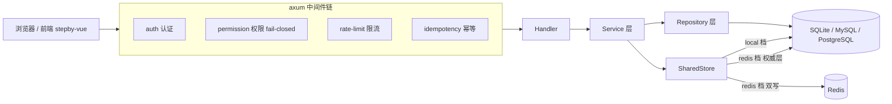

# Stepby Axum


[](https://github.com/stepbylabs/stepby-axum/actions/workflows/ci.yml)

Stepby 开源中后台管理系统的后端服务，基于 **Rust（axum + sea-orm + tokio）** 构建，提供完整的 RESTful API。配套前端仓库：[stepby-vue](https://github.com/stepbylabs/stepby-vue)。

## ✨ 核心特性

### 认证与安全

- **JWT 认证**：argon2 密码哈希、TOTP 双因子（2FA）、WebAuthn / Passkey 支持
- **权限 fail-closed**：默认拒绝，未显式授权一律拦截
- **敏感操作独立限流**：登录、改密等关键路径单独限流通道
- **日志脱敏**：敏感字段在日志输出前自动掩码
- **验证码开关**：`sys.account.captchaEnabled` 运行时参数控制

### 多租户

- 租户管理、套餐能力位、租户间权限与数据隔离

### SSO / OIDC Provider

- 标准授权码模式，RS256 签名的 id_token
- Refresh Token 轮换与重放拒绝
- SCIM Group 同步
- JWKS 公钥端点，供第三方应用独立验签

### 审批工作流

- 流程定义版本化与发布不可变、聚合判定单点收敛
- 加签 / 减签 / 委派，操作后自动重新收敛
- 图驱动单据（flow_graph_doc）、超时自动扫描
- 提醒通知与防打扰机制

### AI 助手

- LLM 接入双源配置：`sys.ai.*` 运行时键覆盖 `config.toml [ai]`，热生效
- AI 问数：受控 NL2SQL，表级白名单防注入，跨租户隔离
- 问数历史留痕（审计大屏域）

### 审计合规

- 操作日志差异对比（变更前后明细）
- 审计变更留痕、审计大屏可视化、合规报告导出
- 审计日志归档：锚点编排 + 链完整性校验 + 归档下载
- 七类日志保留期自动清理（cron 与手动触发同源）

### 细粒度权限

- 数据权限规则（挂角色生效，查询期显式注入）
- 字段级权限矩阵（全量覆盖语义）
- PAT（Personal Access Token）、敏感操作独立限流

### SharedStore 双档共享态

`[cache].mode = auto | local | redis`：

| 档位 | 说明 |
| --- | --- |
| `local` | 业务同库纯 SQL 承载，**单文件零依赖部署**，无 Redis 也能跑 |
| `redis` | Redis + DB 权威层双写，启动回填，适合多实例横向扩展 |

档位切换无缝衔接，`auto` 模式按环境自动选择；`CACHE_MODE` 环境变量可覆盖配置文件。

### 可观测性

- Prometheus `/metrics` 端点
- 慢请求 / 错误日志聚合

## 🏗 架构



## 🚀 快速开始

零配置单文件，3 步启动：

1. 编译或下载 `stepby-axum` 可执行文件（`cargo build --release`，rustls 实现无 OpenSSL 依赖）
2. 双击运行（Linux/macOS 直接执行）——自动创建 SQLite 数据库与 `data/secret.key` 引导密钥，无需任何配置
3. 访问 `http://localhost:8080/health` 验证服务就绪

默认账号：

```
账号：admin
密码：admin123
```

> 首次登录强制修改密码。验证码可通过参数 `sys.account.captchaEnabled` 开关。

### 编译

```bash
# 一体化构建（推荐）：先出前端产物并镜像复制到 frontend-dist/，再编后端
# 三仓并列在同一根目录下时，一条命令覆盖 embedded → frontend-dist → prod → cargo
powershell -File ../scripts/build-all.ps1 -Release -Jobs 4

# 仅编后端（Rust 1.96+，跟随 stable channel）：rust-embed 在编译期嵌入
# stepby-axum/frontend-dist/，该目录必须是本次前端产物，否则产出的是
# "新后端 + 旧界面"且不会有任何提示（详见 docs/deployment.md §3.3）
cargo build --release

# 前端（Node 20+，pnpm 兼容），见 stepby-vue 仓库
pnpm install && pnpm build:prod
```

## ⚙️ 配置

单文件零配置即可运行；需要定制时创建 `config.toml`（参考 `config.toml.example`）：

| 配置段 | 说明 |
| --- | --- |
| `[server]` | 监听地址与端口、文档开关等 |
| `[database]` | SQLite / MySQL / PostgreSQL 连接（SQLite 默认零配置） |
| `[redis]` | Redis 连接信息（redis 档需要） |
| `[cache]` | SharedStore 档位：`mode = auto \| local \| redis`，环境变量 `CACHE_MODE` 可覆盖 |
| `[features]` | SSO 等功能开关 |

### Docker

`docker-compose.yml` 提供 postgres / redis / mysql 测试基础设施：

```bash
docker compose up -d
```

## 🧪 测试

```bash
cargo test --lib    # 1349 个单元测试通过
```

前端 E2E（Playwright，135 个功能 / 1173 项断言）位于前端仓库 `tests/e2e/main.mjs`，详见 [stepby-vue](https://github.com/stepbylabs/stepby-vue)。

## 📦 版本

变更历史见 [CHANGELOG.md](CHANGELOG.md)。当前版本 **v0.2.0**（2026-10-12）。

## 📄 License

[MIT](LICENSE) © 2026 Stepby
